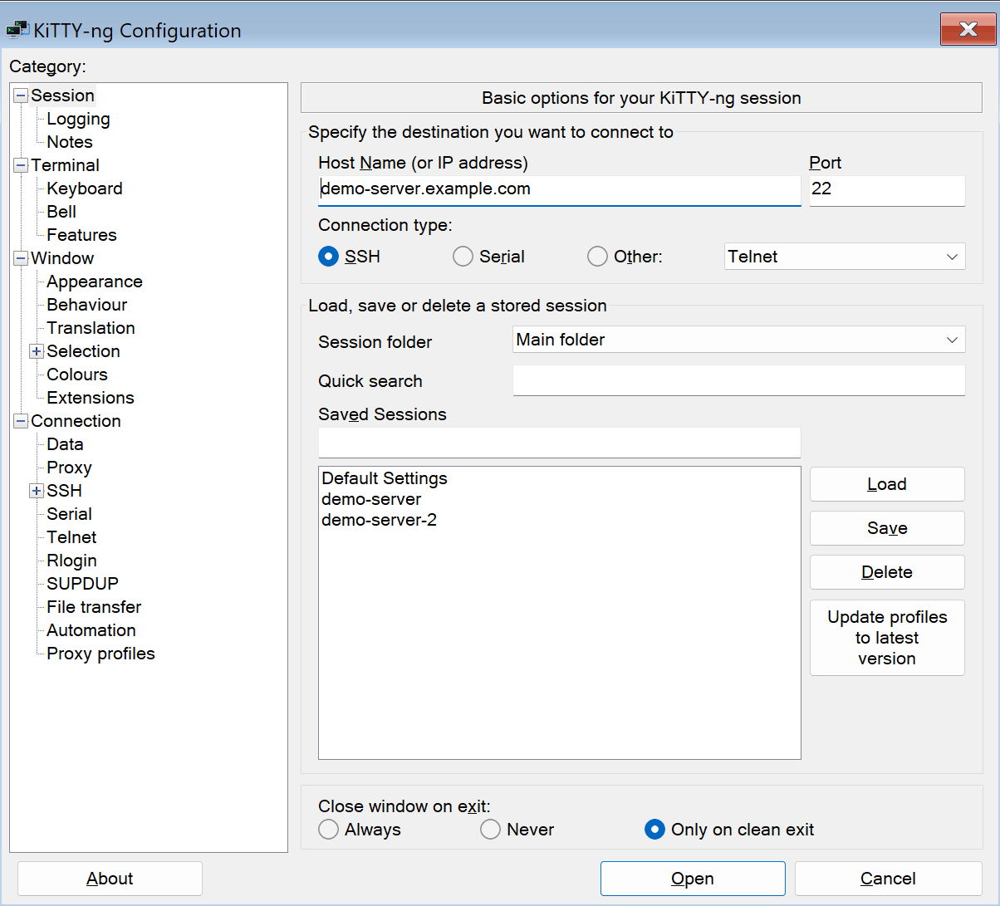
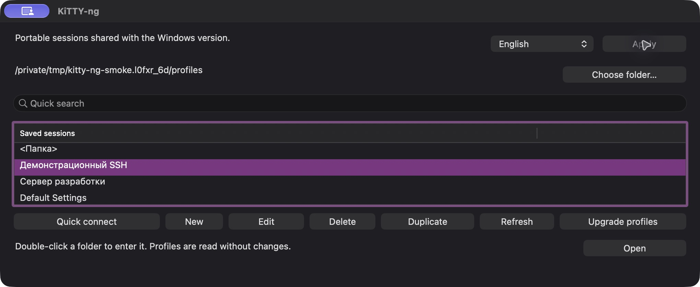
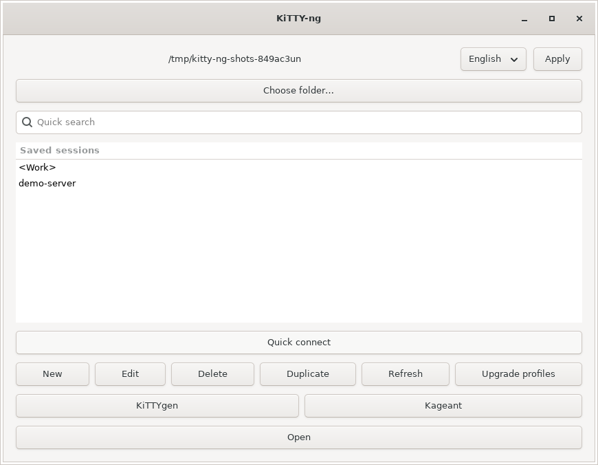

# KiTTY-ng

**0.85-6 is in preparation**: unsaved quick connections on Linux/macOS and standard editing shortcuts in macOS fields. [Release notes](docs/releases/0.85-6.md). Download links are prepared for 0.85-6 and become available after coordinated publication of all packages.

[Русский](README.md) | **English**

**Portable SSH client for Windows, macOS and Linux.** A continuation of KiTTY on PuTTY 0.85, with English and Russian interfaces, session management, SSH keys, file transfers and automation.

**Portable macOS app with shared Windows profiles.** Keep `KiTTY-ng.app` beside the Windows EXEs and use one `Sessions` directory. Settings and keys stay outside the app; internal file references can be relative to the shared folder.

## Download

| Platform | Release 0.85-5 | Launch |
| --- | --- | --- |
| Linux x86_64 | [AppImage](https://github.com/nr084/kitty-ng/releases/download/v0.85-6/kitty-ng-0.85-6-x86_64.AppImage) · [AppDir](https://github.com/nr084/kitty-ng/releases/download/v0.85-6/kitty-ng-0.85-6-x86_64.tar.zst) | `chmod +x`, launch |
| Windows x64 | [ZIP](https://github.com/nr084/kitty-ng/releases/download/v0.85-6/kitty-ng-0.85-6-x64.zip) | `kitty-ng-x64.exe` |
| Windows x86 | [ZIP](https://github.com/nr084/kitty-ng/releases/download/v0.85-6/kitty-ng-0.85-6-x86.zip) | `kitty-ng-x86.exe` |
| Windows arm64 | [ZIP](https://github.com/nr084/kitty-ng/releases/download/v0.85-6/kitty-ng-0.85-6-arm64.zip) | `kitty-ng-arm64.exe` |
| macOS 13+ · Intel / Apple Silicon | [Universal DMG](https://github.com/nr084/kitty-ng/releases/download/v0.85-6/kitty-ng-0.85-6-macos-universal.dmg) | `KiTTY-ng.app` |

[All releases and checksums](https://github.com/nr084/kitty-ng/releases). Each package includes the client and five utilities. Windows EXE names include their architecture; versions are embedded in the programs and included in archive names.

## First launch

1. Download your platform build. Extract the Windows ZIP; on Mac, copy the `.app` from the DMG into a writable folder and eject the image. On Linux, make the AppImage executable (`chmod +x file.AppImage`) and run it; use AppDir or `--appimage-extract-and-run` without FUSE.
2. Place the client beside your existing `kitty.ini`, `Sessions` and `SshHostKeys`, or select the profiles folder. Windows archives include `kitty-ng.portable`.
3. Open a profile or create an SSH session. Choose a language and click **Apply**.

The Mac app uses an ad-hoc signature without Developer ID or notarization. If blocked, use **System Settings → Privacy & Security → Open Anyway**.

## Features

- Session folders, case-insensitive quick search, editing and duplication.
- Original KiTTY profile format and portable key/certificate references.
- SCP/SFTP through kscp, drag-and-drop uploads and downloads.
- KiTTYgen, Kageant and authentication settings from the current session.
- Post-login commands and UTF-8 scripts, delays and reconnection.
- Terminal settings, shortcuts, English and Russian interfaces.

## Screenshots

### Windows

### macOS Universal

KiTTYgen — macOS

### Linux · GTK 3

## Guides

- [Documentation](docs/README.en.md).
- [Windows](docs/windows.en.md) · [macOS](docs/macos.en.md) · [Linux](docs/linux.en.md).
- [Portable profiles and migration](docs/portable.en.md).
- [Local builds](docs/build.en.md) · [Migration report](docs/migration.md) (Russian).
- [0.85-6 release notes](docs/releases/0.85-6.md) · [Roadmap](docs/planned.md) (Russian).

## Compatibility and validation

KiTTY saved passwords use a reversible format, not a secure secrets vault. Entire profiles encrypted with a master password are unsupported. Retired extensions are listed in the [decision matrix](docs/kitty-migration-decisions.json).

The user confirmed operation on a MacBook Air M3 and Windows ARM64. Automated native Windows checks ran on x64/x86. The current local macOS build is compiled and tested on Mac: ARM64 and x86_64 through Rosetta, SSH, keys, transfers and AppKit. Physical Intel Macs, macOS 13, GSSAPI and real SSH CA handshakes still require dedicated validation. See the [native Mac report](docs/macos-native-validation.md) (Russian).

## Acknowledgements and licenses

Thank you to **Simon Tatham** and all [PuTTY contributors](https://www.chiark.greenend.org.uk/~sgtatham/putty/) for the terminal and SSH implementation that forms the foundation of kitty-ng. Special thanks to **Cyril Dupont (cyd01)**, the author of [KiTTY](https://github.com/cyd01/KiTTY), for its extensions and portable workflow, whose compatibility we continue to preserve.

Original copyright notices and license texts are retained separately in [the PuTTY license](LICENCE) and [the KiTTY license](LICENCE-KiTTY.txt). kitty-ng is an independent continuation maintained by **nr084**.

The base is [PuTTY 0.85](https://www.chiark.greenend.org.uk/~sgtatham/putty/latest.html). The original KiTTY history is preserved through commit `75fa2abcd220c17249ff7252f8d5224137001f2d`.

The new connected-terminal icon is available as [the image source](icons/kitty-ng.png), with [generation details](icons/kitty-ng-prompt.txt).
