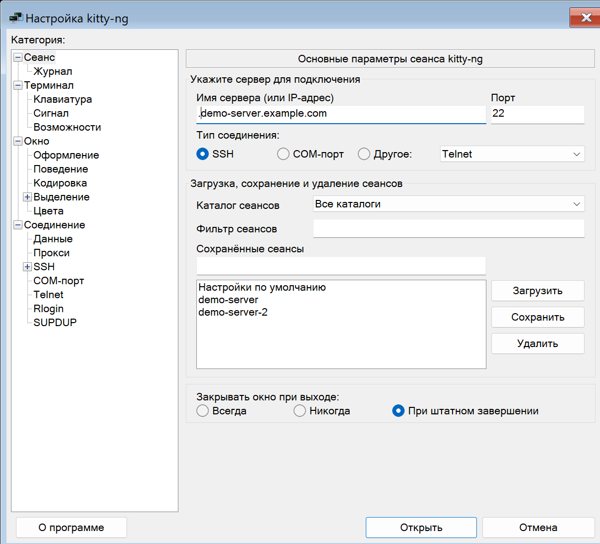
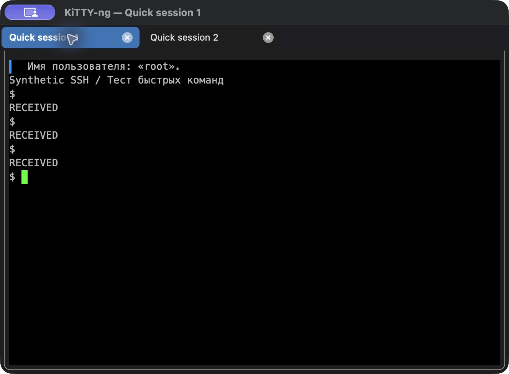
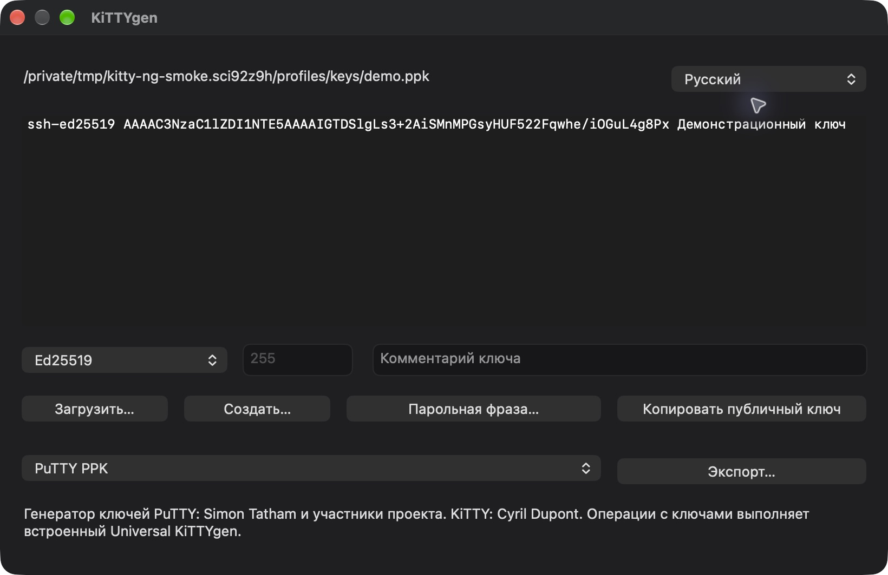
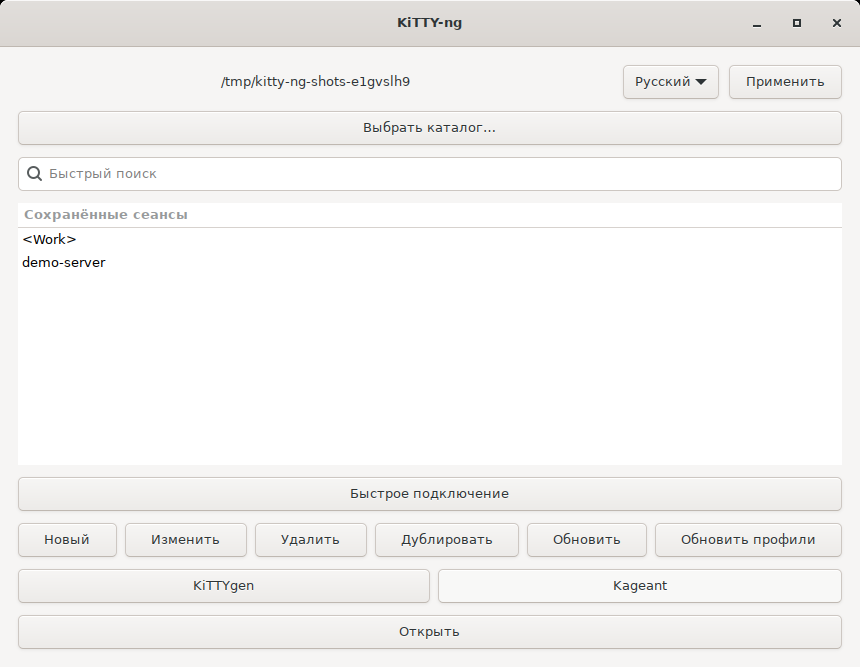

# KiTTY-ng

**SSH-клиент, передача файлов и портативные сеансы для Windows, macOS и Linux.**

KiTTY-ng развивает возможности KiTTY на современной базе **PuTTY 0.85**. Управляйте подключениями, работайте в нескольких вкладках, передавайте файлы, создавайте SSH-ключи и автоматизируйте повседневные команды. Русский и английский интерфейсы встроены в клиент и утилиты.

**Русский** | [English](README.en.md)

[Скачать 0.85-10](https://github.com/nr084/KiTTY-ng/releases/tag/v0.85-10) · [Изменения выпуска](docs/releases/0.85-10.md) · [Руководства](docs/README.md) · [Плагин Total Commander](kitty-ng-fs/README.md)

**macOS Universal 2 и портативный режим.** Одно приложение для Apple Silicon и Intel. Профили совместимы с Windows: используйте общую папку `Sessions`, ключи и `kitty.ini`. Данные хранятся вне `.app`, а ссылки на файлы внутри портативной папки могут быть относительными.

## Скачать

Выпуск 0.85-10 включает шесть проверенных пакетов для Windows, macOS и Linux.

| Платформа | Сборка 0.85-10 | Запуск |
| --- | --- | --- |
| Linux x86_64 | [AppImage](https://github.com/nr084/kitty-ng/releases/download/v0.85-10/kitty-ng-0.85-10-x86_64.AppImage) · [AppDir](https://github.com/nr084/kitty-ng/releases/download/v0.85-10/kitty-ng-0.85-10-x86_64.tar.zst) | `chmod +x`, запуск |
| Windows x64 | [ZIP](https://github.com/nr084/kitty-ng/releases/download/v0.85-10/kitty-ng-0.85-10-x64.zip) | `kitty-ng-x64.exe` |
| Windows x86 | [ZIP](https://github.com/nr084/kitty-ng/releases/download/v0.85-10/kitty-ng-0.85-10-x86.zip) | `kitty-ng-x86.exe` |
| Windows arm64 | [ZIP](https://github.com/nr084/kitty-ng/releases/download/v0.85-10/kitty-ng-0.85-10-arm64.zip) | `kitty-ng-arm64.exe` |
| macOS 13+ · Intel / Apple Silicon | [Universal DMG](https://github.com/nr084/KiTTY-ng/releases/download/v0.85-10/kitty-ng-0.85-10-macos-universal.dmg) | `KiTTY-ng.app` |

[Все релизы и контрольные суммы](https://github.com/nr084/kitty-ng/releases). В комплекте клиент и пять утилит. Имена Windows EXE содержат архитектуру; версия указана внутри программ и в именах архивов.

## Первый запуск

1. Скачайте свою сборку. На Windows распакуйте ZIP; на Mac скопируйте `.app` из DMG в доступную для записи папку и извлеките образ. В Linux сделайте AppImage исполняемым (`chmod +x файл.AppImage`) и запустите его; при отсутствии FUSE используйте AppDir или `--appimage-extract-and-run`.
2. Для существующих настроек разместите клиент рядом с `kitty.ini`, `Sessions` и `SshHostKeys` либо выберите папку профилей. Windows-архивы содержат маркер `kitty-ng.portable`. На Mac это папка, содержащая `KiTTY-ng.app`, а не каталог внутри приложения. Сеансы рядом с `.app` обнаруживаются автоматически; выбранная вручную папка запоминается.
3. Откройте профиль или создайте SSH-сеанс. Выберите язык и нажмите **Применить**.

На Mac используется ad-hoc подпись без Developer ID и нотариального заверения. Если запуск заблокирован: **Настройки системы → Конфиденциальность и безопасность → Всё равно открыть**.

## Возможности

### Подключения и безопасность SSH

- Вход по паролю, SSH-ключу или через агент; поддержка keyboard-interactive и SSH-сертификатов.
- Проверка ключа сервера и сохранение доверенных ключей; настройка алгоритмов обмена ключами и шифрования.
- Локальное, удалённое и динамическое перенаправление портов SSH.
- Подключение через прокси и общие профили из каталога `Proxies`.
- Настраиваемое переподключение после потери связи. Особенности восстановления после сна и аутентификации описаны в руководстве своей платформы.

### Сеансы и вкладки

- Сохранённые подключения во вложенных папках, быстрый поиск без учёта регистра, создание, изменение, удаление и дублирование профилей.
- Дублирование активного сеанса в новой вкладке; переключение мышью, перетаскивание для изменения порядка и отдельные кнопки закрытия.
- Контекстное меню вкладки: дублировать, закрыть, переместить влево или вправо. При одном сеансе полоса вкладок скрыта; режим вкладок можно отключить.
- Быстрое подключение без сохранения профиля на macOS и Linux; его дубликаты также остаются временными.
- Заметки к сеансам и изменение настроек открытого подключения.

[Работа с вкладками](docs/tabs.md)

### Файлы и внешние инструменты

- Отправка и получение файлов по SCP/SFTP с помощью встроенного `kscp`, включая несколько файлов и каталоги.
- Перетаскивание локальных файлов в окно SSH-терминала для отправки.
- Передача помощнику параметров текущего подключения: адреса, порта, прокси и настроек аутентификации.
- Интерактивная работа с удалёнными файлами через `ksftp`.
- **Windows:** запуск внешнего WinSCP из меню с настройкой пути к установленной программе. WinSCP не входит в комплект.
- **Total Commander:** отдельный плагин kitty-ng-fs открывает SFTP прямо в файловых панелях; подробнее ниже.

### Автоматизация

- Автоматические команды после входа по SSH и начальные скрипты в UTF-8.
- Настраиваемые задержки после входа, между строками и символами; ручная отправка команды или файла скрипта.
- Горячие клавиши для действий клиента и отправки текста.
- **Быстрые команды:** до 20 именованных команд, общих для всех сеансов. Для каждой можно включить отправку Enter. Редактирование — **Окно → Быстрые команды**; хранение — в общих настройках, а не в файлах профилей.

Скрипты отправляются в удалённый терминал. [Настройка быстрых команд](docs/quick-commands.md) · [Перенесённые расширения KiTTY](docs/migration.md)

### Терминал и оформление

- Настройки шрифта, цветов, кодировки, клавиатуры, прокрутки и поведения окна; работа с Unicode и полноэкранными терминальными приложениями.
- Копирование и вставка, защита ввода, полноэкранный режим и журнал событий подключения.
- Открытие HTTP/HTTPS-ссылок по Ctrl + щелчку. Запись в буфер обмена через OSC 52 разрешается отдельно; чтение буфера удалённым приложением не поддерживается.
- **Windows:** светлая, тёмная или автоматическая системная тема клиента и GUI-утилит, сворачивание в трей, прозрачность и режим поверх других окон.
- **macOS:** нативный интерфейс AppKit и меню активного сеанса. **Linux:** интерфейс GTK 3 и оформление средствами рабочего окружения.
- Русский и английский интерфейсы через общее языковое ядро. Пользовательские данные и текст удалённого сервера не переводятся.

[Темы Windows](docs/windows-themes.md)

### Портативные настройки

Сохраняется совместимость с файловым форматом оригинального KiTTY: `Sessions`, `SshHostKeys`, `Proxies` и `kitty.ini`. Общую папку можно использовать на Windows, macOS и Linux. Ключи, отдельные сертификаты, скрипты и значки внутри портативного корня сохраняют относительные ссылки; внешние файлы используют абсолютные пути.

На Windows доступны портативное и реестровое хранилища. Общие профили не означают одинаковый набор платформенных функций: особенности и ограничения перечислены в руководствах [Windows](docs/windows.md), [macOS](docs/macos.md) и [Linux](docs/linux.md).

[Портативный режим и переход с KiTTY](docs/portable.md)

### Пять утилит в комплекте

| Утилита | Назначение |
| --- | --- |
| **KiTTYgen** | Создание SSH-ключей, загрузка и экспорт, смена парольной фразы, копирование публичного ключа. |
| **Kageant** | Агент SSH: хранение загруженных ключей в памяти и аутентификация подключений. |
| **Klink** | Подключения и выполнение команд из командной строки. |
| **Kscp** | Передача файлов и каталогов по SCP/SFTP. |
| **Ksftp** | Интерактивный SFTP-клиент для управления удалёнными файлами. |

В Windows утилиты соответствуют архитектуре клиента; в macOS все пять помощников — Universal 2. Linux-пакеты включают клиент и помощников в одном AppImage/AppDir.

## Total Commander · kitty-ng-fs

[KiTTY-ng FS](kitty-ng-fs/README.md) — отдельный WFX-плагин для **Windows x86/x64**. Открывает SFTP в панелях Total Commander через встроенное ядро PuTTY/KiTTY-ng и существующие портативные SSH-сеансы: вложенные группы, передача файлов, переименование, каталоги и Unix-права.

[Скачать плагин 1.1.1](https://github.com/nr084/KiTTY-ng/releases/download/kitty-ng-fs-v1.1.1/kitty-ng-fs-1.1.1-x86-x64.zip) · [Исходники отдельно](https://github.com/nr084/KiTTY-ng/releases/download/kitty-ng-fs-v1.1.1/kitty-ng-fs-1.1.1-source.zip) · [Установка и ограничения](kitty-ng-fs/README.md)

**Совместимость имён:** `mail.example.ru` отображается как `mail·example·ru`, без переноса окончания в колонку расширения. Исходное имя подключения и имена удалённых файлов сохраняются; поддерживаются старые пути сеансов.

**Новое в 1.1.1:** скачивание использует очередь запросов для ускорения на сетях с задержкой; журнал показывает переданный объём в МиБ. Файловые соединения работают внутри WFX без внешних EXE. Поддерживаются пароль, keyboard-interactive, PPK и подтверждение серверного ключа через TC. Клиент и плагин выпускаются независимо; установленный KiTTY-ng нужен только для необязательного открытия терминала.

## Интерфейс

### Windows

### macOS Universal

KiTTYgen — macOS

### Linux · GTK 3

## Руководства

- [Документация](docs/README.md).
- [Windows](docs/windows.md) · [macOS](docs/macos.md) · [Linux](docs/linux.md).
- [Портативные профили и переход с KiTTY](docs/portable.md).
- [Локальная сборка](docs/build.md) · [Перенос расширений](docs/migration.md).
- [Изменения 0.85-10](docs/releases/0.85-10.md) · [Следующие задачи](docs/planned.md).

## Совместимость и проверка

Сохранённые пароли KiTTY имеют обратимый формат; это не защищённое хранилище. Полностью зашифрованные профили с мастер-паролем не поддерживаются. Исключённые расширения перечислены в [матрице решений](docs/kitty-migration-decisions.json).

Пользователь подтвердил работу на MacBook Air M3 и Windows ARM64. Автоматические нативные проверки Windows выполнены на x64/x86. Текущая локальная сборка macOS собирается и проверяется на Mac: ARM64 и x86_64 через Rosetta, SSH, ключи, передачи и AppKit. Сертификаты сервера и пользователя проверены реальным OpenSSH handshake на обоих срезах Mac. Физический Intel Mac, macOS 13 и GSSAPI требуют отдельной проверки. Подробности — [нативный отчёт Mac](docs/macos-native-validation.md).

## Благодарности и лицензии

Спасибо **Саймону Тэтэму (Simon Tatham)** и всем участникам [PuTTY](https://www.chiark.greenend.org.uk/~sgtatham/putty/): их работа составляет основу KiTTY-ng. Отдельная благодарность **Сирилю Дюпону (Cyril Dupont, cyd01)**, автору [KiTTY](https://github.com/cyd01/KiTTY), за расширения и удобство портативного клиента, совместимость с которым мы сохраняем.

Оригинальные уведомления об авторских правах и тексты лицензий PuTTY и KiTTY сохранены в отдельных файлах. KiTTY-ng — самостоятельный проект nr084, продолжающий эту работу.

База: [PuTTY 0.85](https://www.chiark.greenend.org.uk/~sgtatham/putty/latest.html). Расширения и совместимость: [KiTTY](https://github.com/cyd01/KiTTY), исходный коммит `75fa2abcd220c17249ff7252f8d5224137001f2d`. История KiTTY сохранена в Git.

См. [лицензию PuTTY](LICENCE) и [лицензию KiTTY](LICENCE-KiTTY.txt). Новый значок с двумя соединёнными терминалами: [исходное изображение](icons/kitty-ng.png), [сведения о генерации](icons/kitty-ng-prompt.txt).

[Общее языковое ядро и правила перевода](docs/localization.md): русский и английский встроены; дополнительные языковые DLL отложены.
