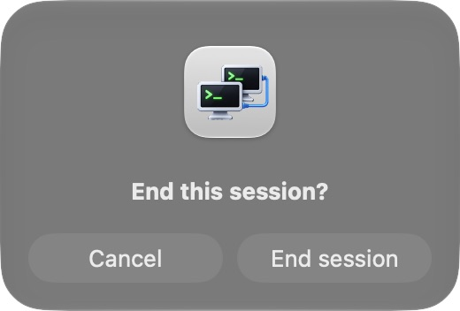
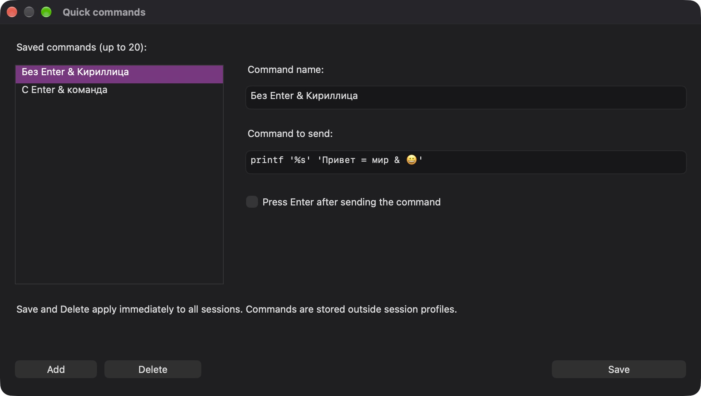
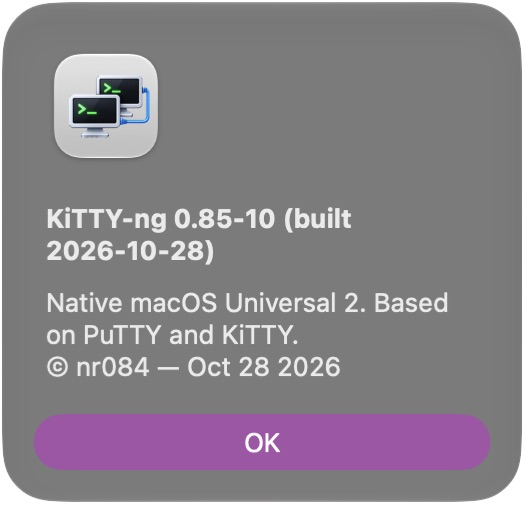
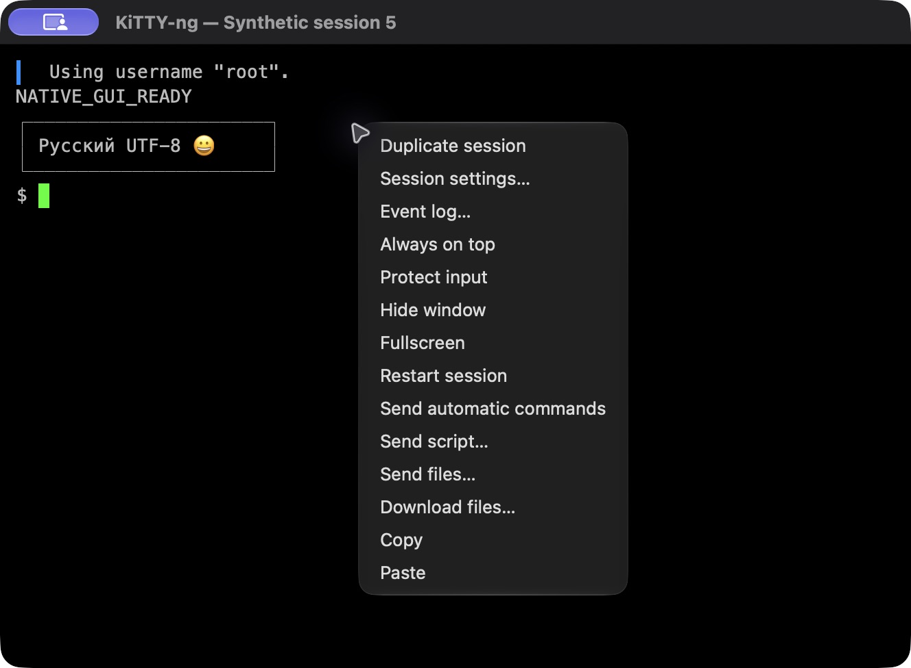
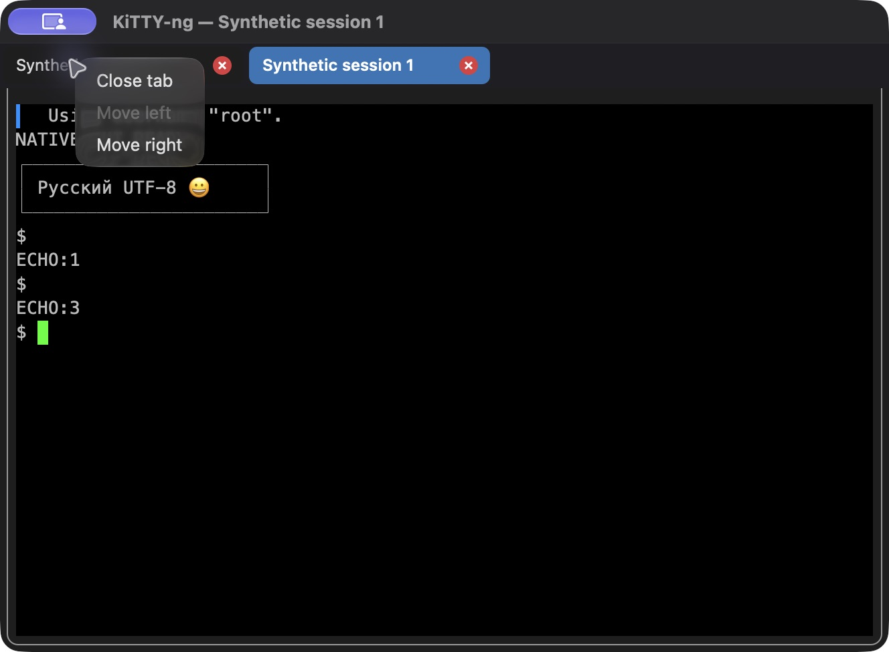
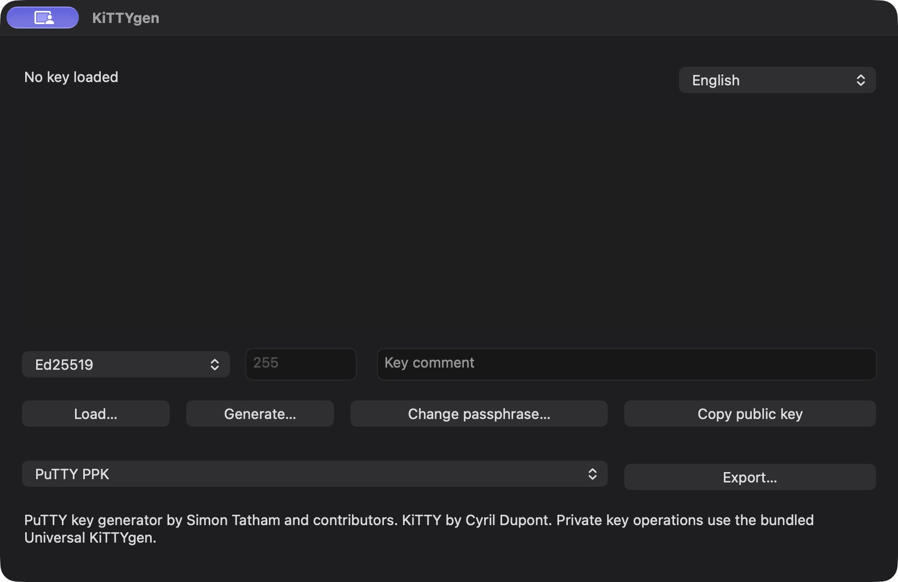

# KiTTY-ng for macOS

[Documentation](README.en.md) | [Русский](macos.md)

**Universal: Apple Silicon and Intel in one app.** The 0.85-10 release is supplied as a DMG and targets macOS 13 or later. The user confirmed basic operation on a MacBook Air M3. The app uses native AppKit UI and the PuTTY 0.85 core.

## Features in 0.85-8 and 0.85-9

Every tab context menu now offers Duplicate session, including inactive tabs. An authenticated source passes its password or key passphrase to an independent copy in memory only. A rejected password prompts again; OTPs and server challenges are never replayed. Closing the source leaves its copy connected, including with SessionTabs=0. The close button is gray normally and red on hover. Duplication in the current host creates no intermediate window and retains fullscreen/zoomed state.

Portable Windows profiles remain shared, with data outside `.app`. The shared RU/EN engine is checked natively for 0.85-9. The Mac DMG joins the published Windows/Linux packages with its own recorded source commit.

## Switching and ending sessions

**Session → Open sessions** lists every connection across all windows, including inactive tabs. The number before a title identifies its window. Selecting an entry activates that tab and restores its hidden or minimized window. Session titles are preserved literally.

**Session → End session** closes only the active tab/connection. Other sessions stay open; the configured close warning is respected.



## Quick commands in 0.85-10

Up to 20 shared commands: configure with **Window → Quick commands**, run from the separate top menu immediately right of **Session** or the terminal context menu. The list is stored in `kitty.ini` outside `.app`, separately from profiles. [Guide](quick-commands.en.md). About shows the version and build date.





## First launch

1. Open `kitty-ng-0.85-10-macos-universal.dmg`.
2. Copy `KiTTY-ng.app` into a writable folder, beside Windows EXEs, `kitty.ini` and `Sessions` if sharing profiles.
3. Eject the DMG and launch the copied app.
4. If no sessions appear, click **Choose folder…** and select the portable root.

Settings remain outside `.app`. The read-only DMG is not suitable for working with profiles. If AppTranslocation changes the launch location, select the settings folder manually.

### Allowing launch

The app has a local ad-hoc signature without Developer ID or Apple notarization. If blocked, use **System Settings → Privacy & Security → Open Anyway**. You may re-sign it on Mac:

```sh
codesign --force --deep --sign - KiTTY-ng.app
codesign --verify --deep --strict --verbose=2 KiTTY-ng.app
```

## Sharing Windows profiles

```text
KiTTY-ng/
├── KiTTY-ng.app
├── kitty-ng-x64.exe
├── kscp-x64.exe
├── kitty-ng.portable
├── kitty.ini
├── Sessions/
├── SshHostKeys/
└── SSH-Keys/
```

Both platforms read original KiTTY portable profiles. Folders appear as `<name>`, `..` goes up, quick search is case-insensitive, and folders sort before sessions. `KITTY_NG_PORTABLE_DIR` selects the root; console helpers also accept `--portable-dir`.

Relative key, certificate and file paths resolve against the shared root. Internal paths become relative when saving; external paths remain absolute. Absolute Windows paths and `%USERPROFILE%` are not translated automatically. Update such profiles on Windows before moving them. See [portable compatibility](portable.en.md).

Unknown profile fields are retained. Mac font and window geometry settings use separate fields. Profiles changed externally are protected from stale writes. Seed files are separate: `kitty-ng-macos.rnd` and `kitty-ng-win.rnd`; `macseedfile` in `putty.conf` overrides the Mac path.

## Profiles and language

**New**, **Edit**, **Delete** and **Duplicate** manage profiles. Duplication asks for a name and opens the copied settings; only **Save** writes the copy. **Refresh** reloads the list; **Upgrade profiles** converts eligible internal file references.

New SSH profiles use port **22**. Choose **English / Русский → Apply** in the main window. KiTTYgen has a dropdown and Kageant has a language menu. The default follows the macOS language; a saved choice takes precedence. Remote output and user data are not translated.

In 0.85-7 the top **Session** menu and terminal context menu expose the same commands. **Duplicate session** opens an independent connection in a new tab of the current window; `SessionTabs=0` opens a separate window. Quick connections and their copies stay temporary: no name prompt, new profile, Sessions or Default Settings writes, including when closing. Temporary session settings reopen without saving a profile. The top menu targets the active terminal and is disabled in other windows. Terminal menus exclude AutoFill. The tab strip is hidden for one session. Click to switch; drag or use the context menu to reorder. The red close button and Close tab end only that tab without confirmation; closing the entire window respects WarnOnClose. Set `SessionTabs=0` in the `[KiTTY]` section of `kitty.ini` to disable tabs for new windows. [Tab guide](tabs.en.md).



## File transfers

Drop files or folders onto an SSH terminal, or use its context menu. Upload uses the known current path when detection is enabled, the configured `PSCPRemoteDir`, or `.` — the home directory of a new connection. It does not ask for a separate destination directory. Use the download command and specify the remote path to receive files. If a terminal application captures the mouse, use **Shift + right-click** for the local menu.

The embedded `kscp` receives current session settings: port, proxy, saved password, key, certificate and agent. Passwords are not command-line arguments or temporary profiles. Helpers reside inside `.app`; PATH is not searched. Multiple files, Unicode names and recursive directories are supported.

## Terminal, automation and utilities

- Profile settings cover connections, authentication, proxies, transfers, automation, windows and notes. **All settings** exposes the persisted PuTTY configuration tree.
- Commands and UTF-8 scripts are sent after the SSH channel is ready, with configurable delays. Scripts are not executed locally.
- Reconnection after network failure or wake, KiTTY `[Shortcuts]`, Cmd+C / Cmd+V, input protection and fullscreen are supported.
- Ctrl+click opens HTTP/HTTPS links. Optional OSC 52 allows clipboard writes only.
- KiTTYgen generates Ed25519/RSA/ECDSA keys, loads keys, changes passphrases, copies public keys and exports PPK/OpenSSH/RFC4716.
- Kageant supports loading/listing keys, removing all keys and stopping the agent. The macOS menu restores hidden terminals.

All five helpers in `Contents/Helpers` are Universal: `klink`, `kscp`, `ksftp`, `kittygen`, `kageant`.

## Special scenarios and limitations

SSH CA settings use `SshHostCAs`; automatic synchronization with the Windows registry CA store is not available. GSSAPI uses the system GSS.framework and requires valid Kerberos credentials. Real OpenSSH host and user certificate handshakes pass on arm64 and x86_64 through Rosetta. Kerberos credentials, physical Intel hardware and the macOS 13 baseline require a separate environment.

Saved KiTTY passwords are reversible. Entire profiles encrypted with a master password are unsupported. Retaining an unknown field does not imply support for its retired extension. See the [macOS matrix](macos-migration.json), [verification scope](validation.md) and [roadmap](planned.md) (technical reports in Russian).

Normal launches on Apple Silicon use ARM64 without Rosetta. Forcing the Intel slice for validation on macOS 27 may trigger a warning about future Rosetta compatibility in macOS 28; that warning concerns Intel execution. [Apple explanation](https://support.apple.com/en-gb/102527).

## Diagnostics and builds

The DMG's `Instructions` folder contains guides and diagnostic `.command` files. Copy these beside the app before use. The diagnostic command produces a log; the smoke-test command uses synthetic data in a temporary directory.

Compilation, signing, DMG packaging and native tests now run on a Mac: [build guide](build.en.md). See the [native validation report](macos-native-validation.md) for coverage and limits.

## Screenshots

Captured on this Mac using synthetic profiles and a disposable test key.





## Quick connections and editing

The first Quick connect button opens temporary SSH/22 settings without a session name. Connect starts a temporary connection without writing a profile, Default Settings or password to Sessions. Cmd+A/C/V/X use the standard responder-chain Edit menu; secure fields retain AppKit clipboard restrictions. The terminal keeps Cmd+C/V and forwards control keys to the remote side.

## Session folder and quitting

The app first checks for sessions in the directory **containing `KiTTY-ng.app`**, outside the bundle and independently of Finder’s working directory. Existing sessions there are used without a folder prompt. Otherwise an available manually selected folder is restored from macOS preferences. Explicit `--portable-dir` and `KITTY_NG_PORTABLE_DIR` take precedence. Windows profile compatibility is preserved.

The **Quit** command at the bottom of the status menu honors session close confirmation. Cancelling leaves all connections open.
