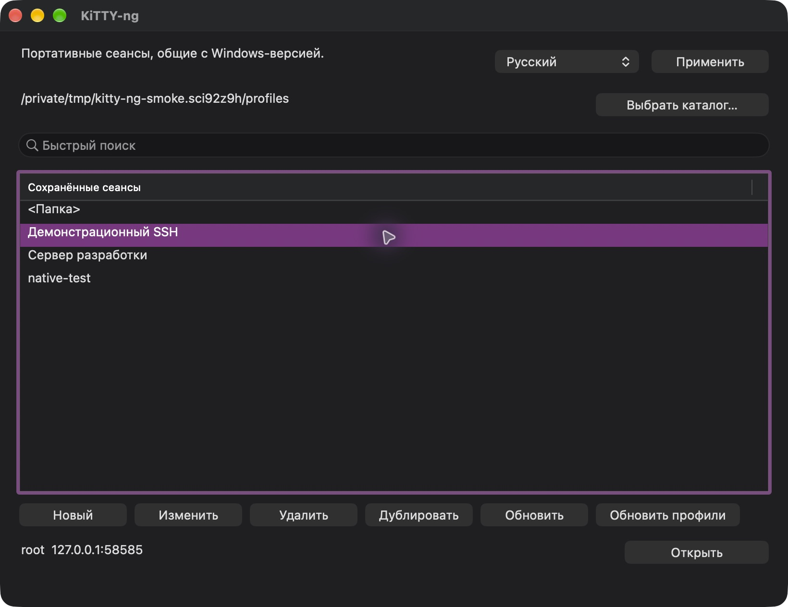

# KiTTY-ng для macOS

[Документация](README.md) | [English](macos.en.md)

**Universal: Apple Silicon и Intel в одном приложении.** Выпуск 0.85-5 поставляется в DMG, требует macOS 13 или новее. Пользователь подтвердил основную работу на MacBook Air M3. Приложение использует нативный интерфейс AppKit и ядро PuTTY 0.85.

## Первый запуск

1. Откройте `kitty-ng-0.85-5-macos-universal.dmg`.
2. Перенесите `KiTTY-ng.app` в доступную для записи папку. Для общих профилей — рядом с Windows EXE, `kitty.ini` и `Sessions`.
3. Извлеките DMG и запустите приложение из выбранной папки.
4. Если сеансы не найдены, нажмите **Выбрать каталог…** и укажите общий портативный корень.

Настройки записываются снаружи `.app`. Образ DMG доступен только для чтения и не подходит для постоянной работы с профилями. При AppTranslocation выберите каталог данных вручную.

### Разрешение запуска

Используется локальная ad-hoc подпись без Developer ID и нотариального заверения Apple. При блокировке: **Настройки системы → Конфиденциальность и безопасность → Всё равно открыть**. При необходимости можно заново подписать приложение на Mac:

```sh
codesign --force --deep --sign - KiTTY-ng.app
codesign --verify --deep --strict --verbose=2 KiTTY-ng.app
```

## Общие профили с Windows

```text
KiTTY-ng/
├── KiTTY-ng.app
├── kitty-ng-x64.exe
├── kscp-x64.exe
├── kitty-ng.portable
├── kitty.ini
├── Sessions/
├── SshHostKeys/
└── SSH-Keys/
```

Обе платформы читают формат исходного портативного KiTTY. Папки показаны как `<имя>`, `..` возвращает вверх, поиск не учитывает регистр; каталоги идут перед сеансами. Корень можно задать через `KITTY_NG_PORTABLE_DIR`; консольные помощники принимают `--portable-dir`.

Относительные пути к ключам, сертификатам и файлам разрешаются от общего корня. Внутренние пути при сохранении преобразуются в относительные; внешние остаются абсолютными. Абсолютные Windows-пути и `%USERPROFILE%` на Mac не преобразуются: предварительно используйте обновление профилей на Windows. Подробности — [совместимость](portable.md).

Сохраняются неизвестные поля профилей. Mac-шрифты и геометрия окна используют отдельные поля. Изменённый извне профиль не перезаписывается без повторного чтения. Seed-файлы платформ разделены: `kitty-ng-macos.rnd` и `kitty-ng-win.rnd`; отдельный Mac-путь задаётся `macseedfile` в `putty.conf`.

## Сеансы и язык

**Новый**, **Изменить**, **Удалить** и **Дублировать** управляют профилями. Дублирование запрашивает имя и открывает настройки копии; запись происходит по **Сохранить**. **Обновить** перечитывает список, **Обновить профили** преобразует подходящие файловые ссылки внутри портативной папки.

Для нового SSH-профиля установлен порт **22**. Выбор языка находится в главном окне: **Русский / English → Применить**. KiTTYgen имеет собственный раскрывающийся список, Kageant — меню языка. По умолчанию используется язык macOS; сохранённый выбор имеет приоритет. Текст удалённого сервера и пользовательские данные не переводятся.

## Передача файлов

Перетащите файлы или каталоги в открытый SSH-терминал либо используйте его контекстное меню. Отправка не требует отдельного вопроса о каталоге: используется известный текущий путь при включённом определении, настроенный `PSCPRemoteDir` либо `.` — домашний каталог нового подключения. Для скачивания выберите **Скачать файлы…** и укажите удалённый путь. В терминальном приложении с захватом мыши местное меню открывается **Shift + правый щелчок**.

Встроенный `kscp` получает настройки текущего сеанса: порт, прокси, сохранённый пароль, ключ, сертификат и агент. Пароль не добавляется в командную строку и не записывается во временный профиль. Помощник находится внутри `.app`; поиск через PATH не используется. Поддерживаются Unicode-имена, несколько файлов и рекурсивные каталоги.

## Терминал, автоматизация и утилиты

- Редактор содержит соединение, аутентификацию, прокси, передачу файлов, автоматизацию, окно и заметки. **Все настройки** открывает дерево сохраняемых параметров PuTTY.
- Автокоманды и UTF-8-скрипты отправляются после готовности SSH-канала с заданными задержками; локально не исполняются.
- Поддерживаются переподключение при потере связи и после пробуждения, сочетания KiTTY из `[Shortcuts]`, Cmd+C / Cmd+V, защита ввода и полный экран.
- Ctrl+щелчок открывает HTTP/HTTPS. OSC 52 разрешает только явно включённую запись в буфер обмена.
- KiTTYgen: генерация Ed25519/RSA/ECDSA, загрузка ключа, смена парольной фразы, публичный ключ и экспорт PPK/OpenSSH/RFC4716.
- Kageant: добавление и список ключей, удаление всех ключей и остановка агента. Меню строки macOS возвращает скрытые терминалы.

Все пять помощников в `Contents/Helpers` также Universal: `klink`, `kscp`, `ksftp`, `kittygen`, `kageant`.

## Совместимость специальных сценариев

SSH CA доступны через меню **Центры сертификации SSH…** и хранятся в `SshHostCAs`. Автоматической синхронизации с реестровым хранилищем CA Windows пока нет. GSSAPI использует системный GSS.framework и требует действующих Kerberos credentials. SSH-сертификаты сервера и пользователя проверены реальным OpenSSH handshake на arm64 и x86_64 через Rosetta. Kerberos credentials, физический Intel Mac и нижняя граница macOS 13 требуют отдельной среды.

Сохранённые пароли KiTTY обратимы; полностью зашифрованные профили с мастер-паролем не поддерживаются. Сохранение неизвестного поля не означает поддержку исключённого расширения. См. [матрицу macOS](macos-migration.json), [область проверки](validation.md) и [следующие задачи](planned.md).

## Диагностика и сборка

В DMG папка `Instructions` содержит инструкции и `.command`-файлы. Для запуска перенесите их рядом с `.app`. `Diagnose KiTTY-ng.command` создаёт диагностический журнал; `Smoke-test KiTTY-ng.command` выполняет нативные проверки на синтетических данных во временной папке.

Сборка, подпись, упаковка DMG и нативные проверки теперь выполняются на Mac: [руководство по сборке](build.md). Подробное покрытие и ограничения — [нативная проверка 13 октября 2026](macos-native-validation.md).

## Интерфейс

Снимки сделаны на Mac с синтетическими профилями и ключом.




