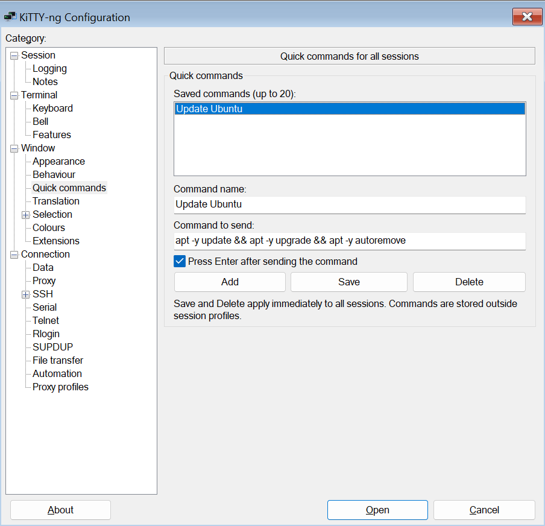

# Quick commands

Open **Window → Quick commands** in KiTTY-ng settings. Commands are shared by all sessions and stored outside individual profiles.

Click **Add**, enter a name and a single-line command, choose whether to send Enter, and click **Save**. Select a saved command to edit or delete it. Save and Delete take effect immediately, independently of closing the settings dialog. Up to 20 commands are supported.

Run a command from **Quick commands**, immediately after **Special Command** in the terminal menu. The text is sent literally to the active remote session. Without Enter, you can review or extend it before execution. Sending is disabled while input is locked or the connection is not ready.



## Storage

Installed Windows: `HKCU\Software\KiTTY-NG\QuickCommands`. Portable Windows, Linux and macOS: the `[QuickCommands]` section of `kitty.ini` in the selected portable root.

```ini
[QuickCommands]
initialized=yes
cmd1_name=Update Ubuntu
cmd1_instruction=apt -y update && apt -y upgrade && apt -y autoremove
cmd1_enter=yes
```

Slots are numbered 1–20. Use `yes` or `no` for Enter. Names and commands retain their original text. Other INI sections are preserved; writes use UTF-16LE with a BOM, supported by the existing Windows/Linux/macOS readers.

On the first run without this section, KiTTY-ng creates the Ubuntu example in the selected interface language. Creating the example does not execute it. Switching languages does not rename user commands, and deleting all commands does not recreate the example.

## macOS

In 0.85-10, open the native editor with **Window → Quick commands**. Run commands from the separate **Quick commands** menu immediately to the right of **Session** in the Mac menu bar, or the terminal submenu after **Special Commands**. The active tab receives the command.

`kitty.ini` lives in the selected portable root outside `.app`. When placed beside the app, this is the directory containing `KiTTY-ng.app`. The format is shared with Windows and Linux.


