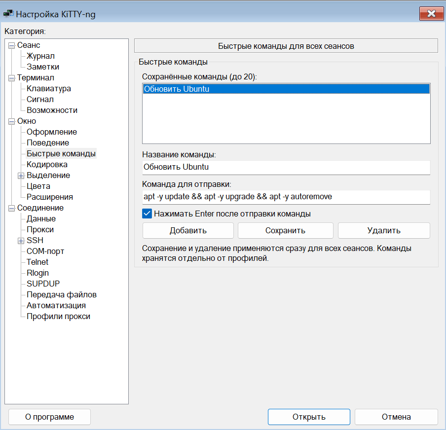
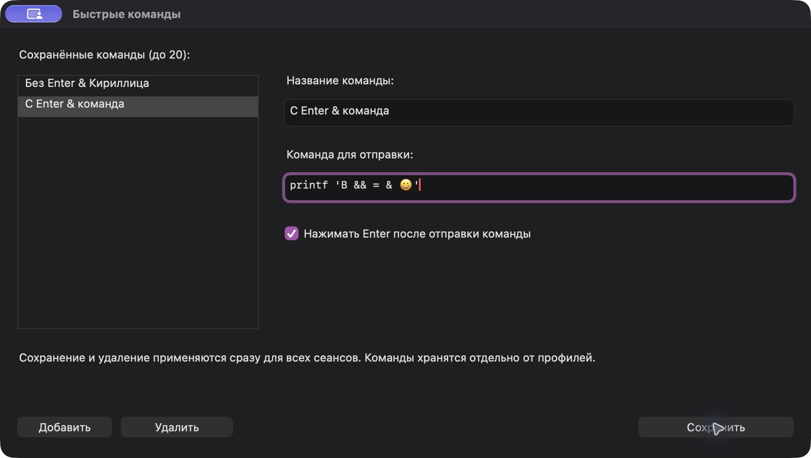

# Быстрые команды

Откройте **Окно → Быстрые команды** в настройках KiTTY-ng. Список общий для всех сеансов и не переносится вместе с отдельным профилем.

Нажмите **Добавить**, введите название и команду, выберите, нужно ли отправлять Enter, затем нажмите **Сохранить**. Для изменения выберите запись в списке; **Удалить** убирает выбранную команду. Сохранение и удаление действуют сразу, независимо от кнопки закрытия окна настроек. Максимум — 20 команд.

Для запуска выберите команду в подменю **Быстрые команды** после **Специальной команды** в меню терминала. Текст передаётся активному удалённому сеансу буквально. Без флажка Enter его можно проверить или дополнить перед выполнением. При блокировке ввода или отсутствии готового подключения отправка отключена.



## Хранение

В установленной Windows-версии: `HKCU\Software\KiTTY-NG\QuickCommands`. В портативном режиме Windows, в Linux и macOS: секция `[QuickCommands]` файла `kitty.ini` в выбранном корне портативных данных.

```ini
[QuickCommands]
initialized=yes
cmd1_name=Обновить Ubuntu
cmd1_instruction=apt -y update && apt -y upgrade && apt -y autoremove
cmd1_enter=yes
```

Доступны номера от 1 до 20. Для Enter используются `yes` и `no`. Название и команда — одна строка; обратные косые черты, кавычки и символы `&` сохраняются буквально. Секции остальных настроек сохраняются. При записи портативный INI использует UTF-16LE с BOM, поддерживаемый существующими читателями Windows/Linux/macOS.

При первом запуске без раздела быстрых команд создаётся пример с названием «Обновить Ubuntu» или «Update Ubuntu» в зависимости от языка. Это не запускает обновление: команда выполняется только после выбора пользователем. Смена языка не переименовывает пользовательские записи. После удаления всех команд пустой раздел остаётся, поэтому пример не создаётся повторно.

## macOS

В 0.85-10 нативный редактор открывается через **Окно → Быстрые команды**. Для запуска используйте отдельное меню **Быстрые команды** справа от **Сеанс** в верхней строке Mac либо одноимённое подменю терминала после **Специальной команды**. Получатель — текущая активная вкладка.

`kitty.ini` находится в выбранном портативном корне, вне `.app`; при размещении рядом с приложением это каталог, содержащий `KiTTY-ng.app`. Формат общий с Windows и Linux.


