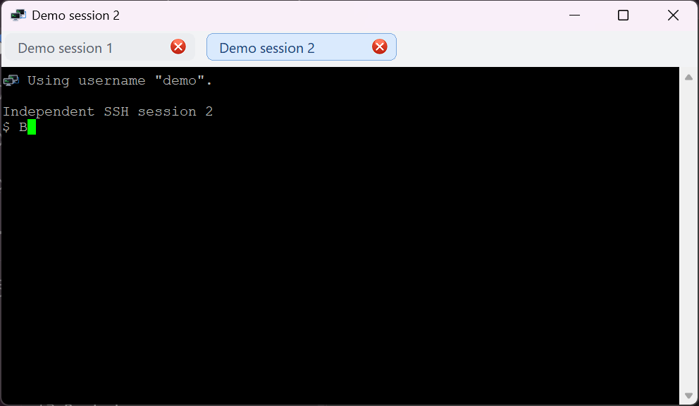
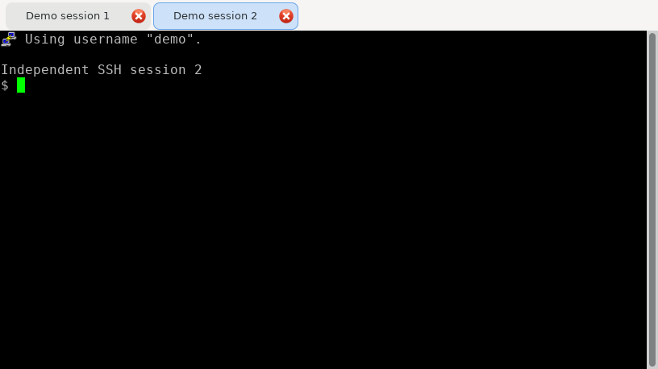

# Вкладки сеансов — Windows и Linux

[Документация](README.md) · [English](tabs.en.md)

В KiTTY-ng 0.85-7 команда **«Дублировать сеанс»** открывает независимое подключение в новой вкладке текущего окна. При одном сеансе полоса вкладок скрыта; при появлении второго отображается сверху. Закрытие вкладки не завершает соседние подключения.

- Активная вкладка выделена голубым цветом; длинное название сокращается многоточием.
- Для изменения порядка перетащите вкладку мышью или нажмите правой кнопкой и выберите **«Переместить влево» / «Переместить вправо»**.
- Красный круг с белым крестиком справа закрывает только эту вкладку. То же делает **«Закрыть вкладку»** в её контекстном меню. Подтверждение при этих действиях не запрашивается, даже если в настройках сеанса оно включено.
- При закрытии всего окна настройка подтверждения продолжает действовать.
- После закрытия предпоследнего сеанса полоса снова скрывается.

## Отключение

Вкладки включены по умолчанию. Чтобы команда дублирования открывала отдельные окна, добавьте в `kitty.ini` портативного каталога:

```ini
[KiTTY]
SessionTabs=0
```

`SessionTabs=1` включает вкладки. Отсутствие ключа означает включённое состояние. Настройку применяйте перед открытием нового окна. Формат сохранённых сеансов не меняется.

macOS получит вкладки отдельной реализацией и нативной проверкой на Mac; в этом этапе функция относится к Windows и Linux.

## Оформление




