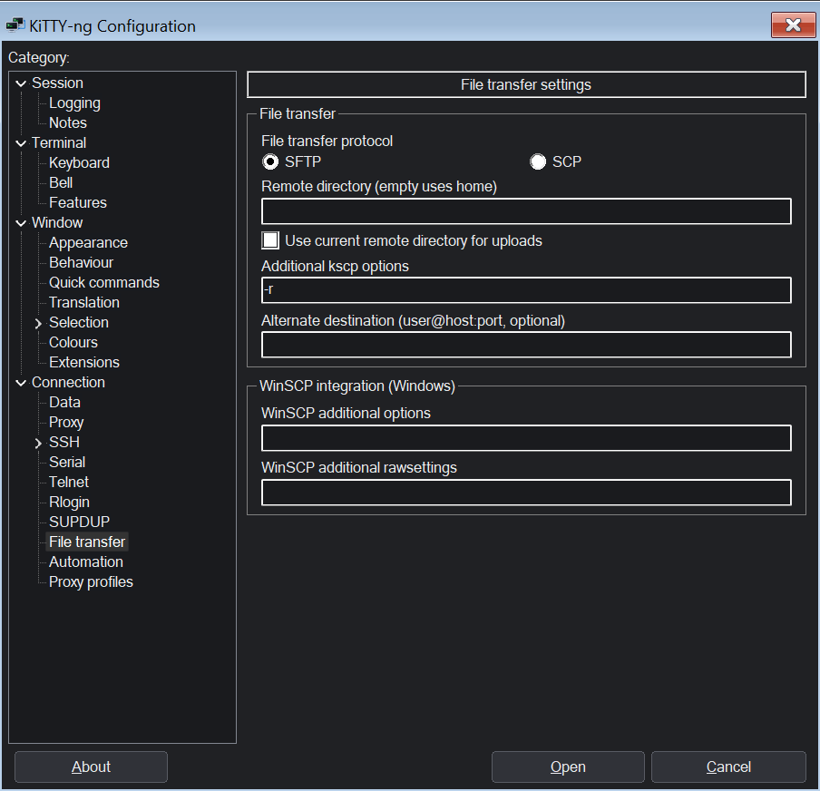
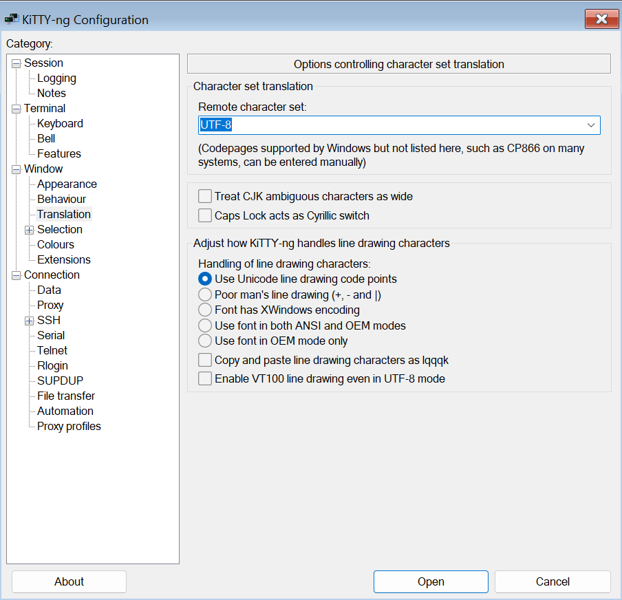
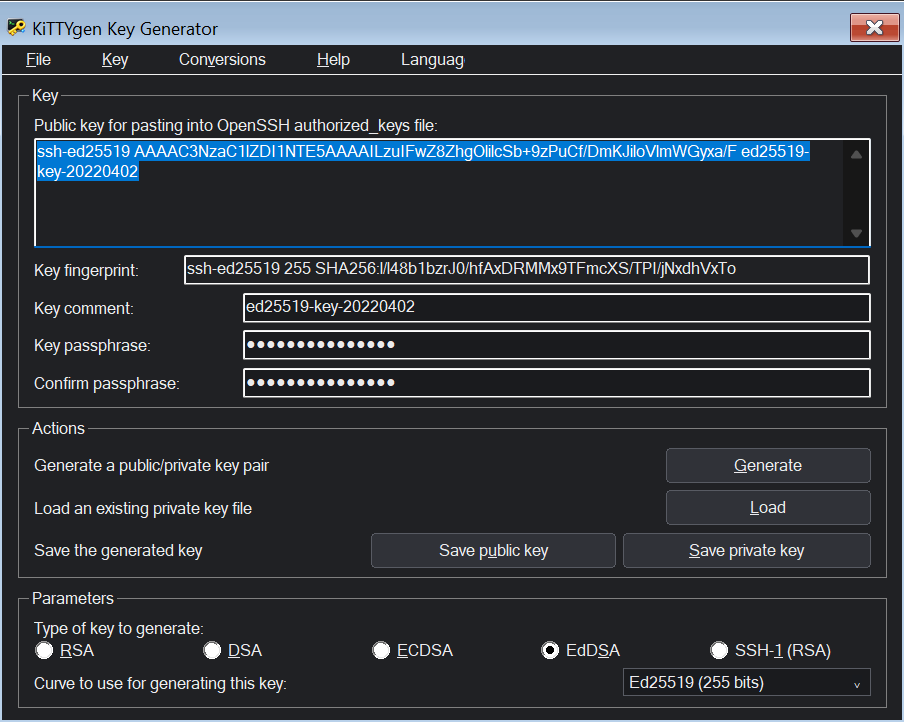
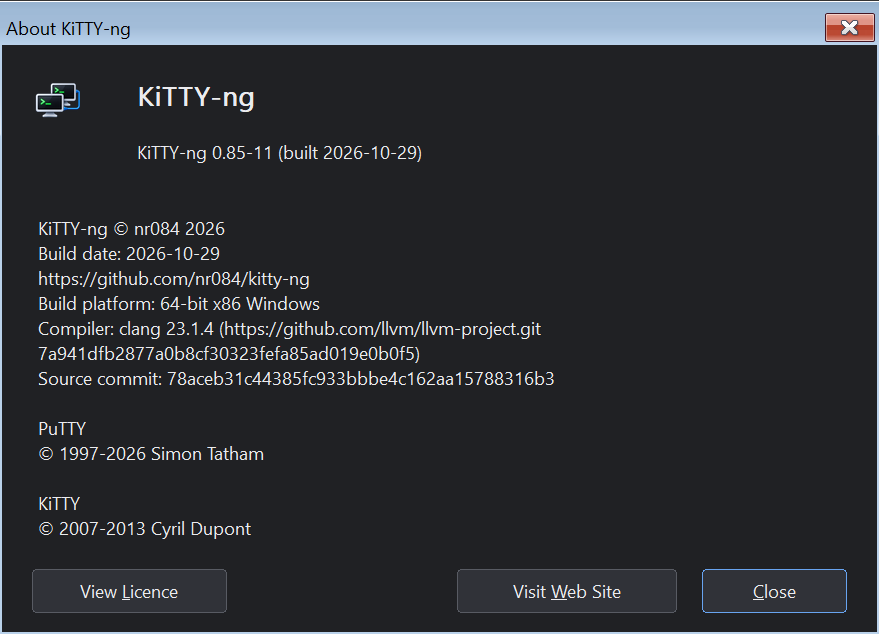

# KiTTY-NG for Windows

[Documentation](README.en.md) | [Русский](windows.md)

Download the appropriate archive from [Releases](https://github.com/nr084/kitty-ng/releases): **x64**, **x86** or **ARM64**. Extract it and run `kitty-ng-x64.exe`, `kitty-ng-x86.exe` or `kitty-ng-arm64.exe`. No installation is required.

Windows is supplied in three archives: `kitty-ng-0.85-3-x64.zip`, `kitty-ng-0.85-3-x86.zip` and `kitty-ng-0.85-3-arm64.zip`. Every executable inside an archive uses the matching architecture suffix. For example, the x64 archive contains:

```text
kitty-ng-x64.exe
klink-x64.exe
kscp-x64.exe
ksftp-x64.exe
kittygen-x64.exe
kageant-x64.exe
```

The other archives use `-x86` or `-arm64`. Executable filenames do not include a release number; embedded version information is retained. Archive checksums are listed in the release description. The utilities are based on Plink, PSCP, PSFTP, PuTTYgen and Pageant from PuTTY 0.85.

Archives enable portable mode through the `kitty-ng.portable` marker. To use registry storage, remove the marker and ensure that `kitty.ini` does not set `savemode=dir`. Registry mode uses `HKCU\Software\KiTTY-NG`.

## Utilities and file transfers

The client launches companion executables of its own architecture from its own directory. For example, the x64 client selects `kscp-x64.exe`. It checks the actual PE architecture and does not search PATH for a replacement. Windows taskbar tasks use the corresponding kageant and kittygen; kageant opens the matching kitty-ng client.

To transfer a file using the matching kscp:

```powershell
.\kitty-ng-x64.exe -launch-utility kscp -load "Production/root" "C:\Files\example.txt" root@example.com:/tmp/
```

`-launch-utility` also accepts `klink`, `ksftp`, `kittygen` and `kageant`. Remaining arguments are passed to the utility, and its exit code is returned. In an open SSH session, drop files or folders onto the terminal window, or use **Send files...** in the window system menu. **Receive file...** downloads a remote file.



**Connection → File transfer** selects SFTP/SCP, the remote directory, kscp options and an optional alternate destination. Legacy KiTTY settings `PSCPRemoteDir`, `PSCPOptions`, `WinSCPProtocol`, `SFTPConnect`, `SCPAutoPwd`, plus `kitty.ini` options `pscpport` and `uploaddir`, are supported. The current-directory option queries `pwd` through an interactive POSIX shell and requires remote window-title changes to be enabled. Upload is cancelled if the directory cannot be obtained within five seconds.

Transfers inherit the current session's SSH port, proxy, keys and saved root password. The saved password reaches the helper through memory, without a temporary profile or a password argument. Multiple files, recursive folders and Unicode names are supported. Keep the matching architecture's client and kscp together.

```powershell
.\kitty-ng-x64.exe -load "Production/root" -upload "C:\Files\example.txt"
.\kitty-ng-x64.exe -load "Production/root" -download "/tmp/example.txt" "C:\Files\example.txt"
```

## Interface language

On first launch, the client and utilities follow the Windows display language: Russian for Russian Windows, English otherwise. A saved selection takes precedence. **KiTTYgen** has a separate **Language → Русский / English** menu; switching saves the preference and preserves the open key. Console utilities accept `--language ru` and `--language en` for local help, messages and confirmation prompts.

In Kageant, right-click the tray icon and select Language → English / Русский. The selection is saved; menus and the open key-list window update immediately, without restarting or unloading keys.

Open **Window → Appearance → Interface language** and select **English** or **Русский** from the dropdown. Click **Apply** beside the dropdown to save the language and immediately update the interface, keeping the current panel open. You can also run `kitty-ng-x64.exe --language en` or `--language ru`.

Configuration panels, menus, standard dialogs and client messages are translated. Session names, host keys, protocol identifiers and remote terminal output retain their original content. License texts remain in their original language.

The screenshots below show the English interface:







