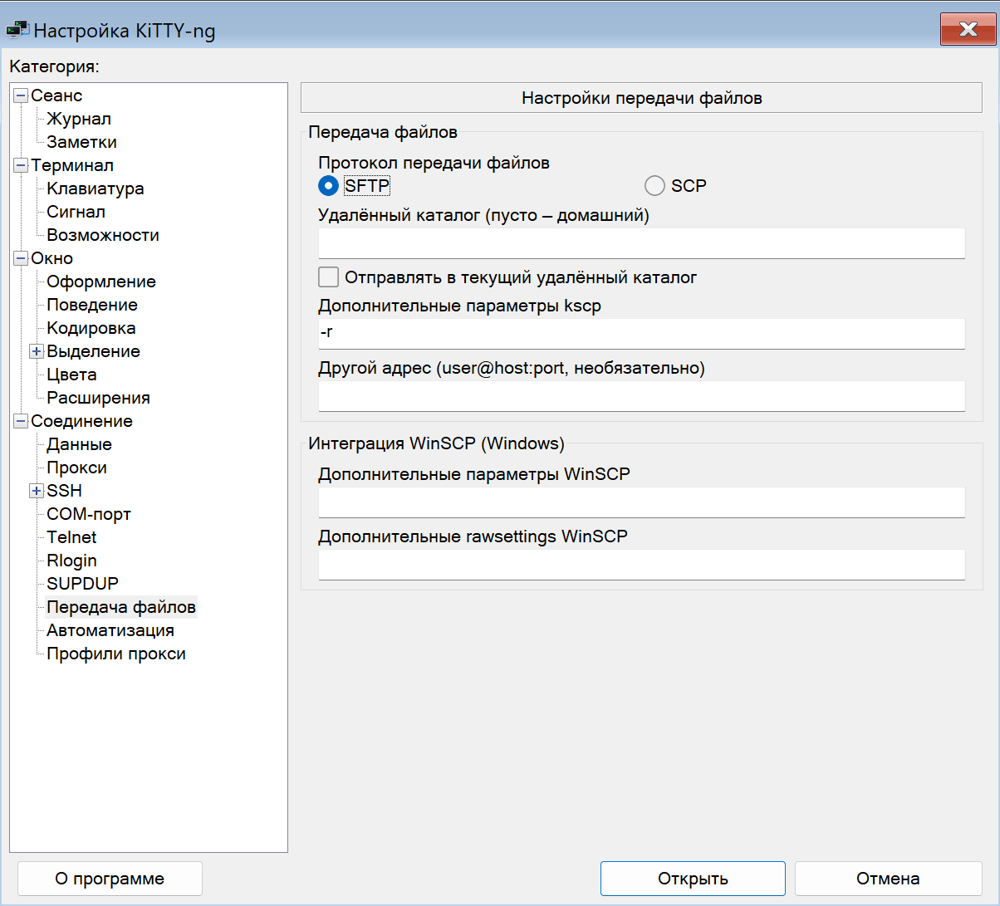
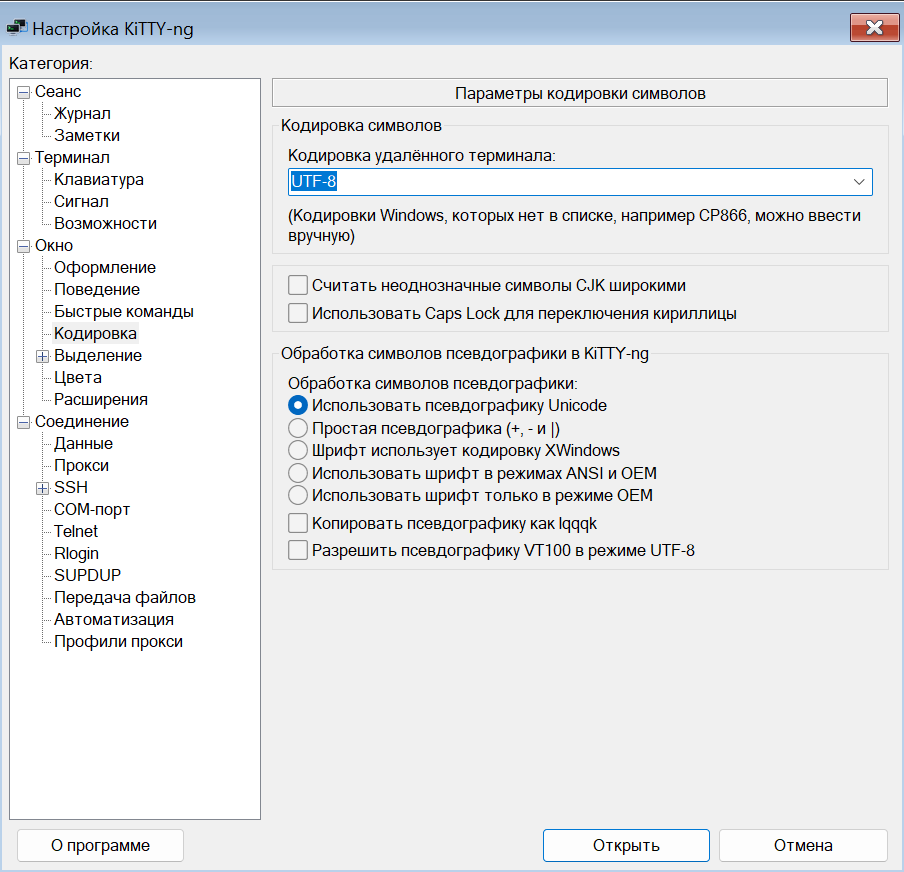
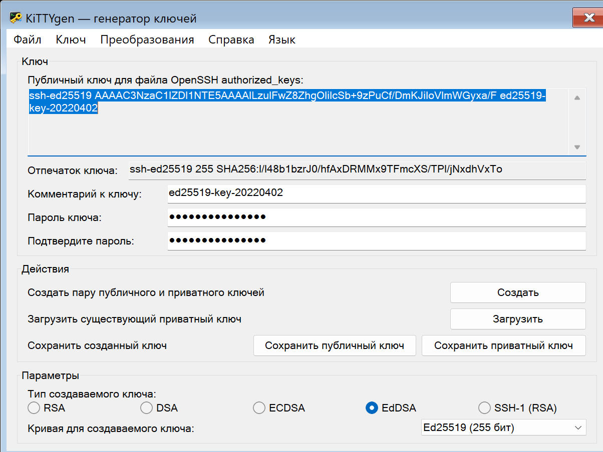
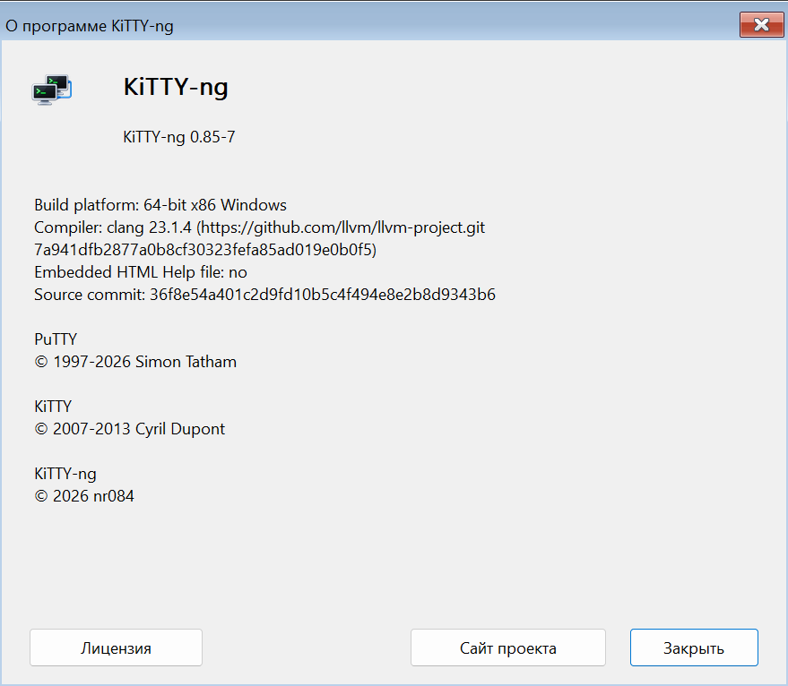

# KiTTY-NG для Windows

[Документация](README.md) | [English](windows.en.md)

Сборки публикуются в [релизах](https://github.com/nr084/kitty-ng/releases). Выберите Windows **x64**, **x86** или **ARM64**, распакуйте архив и запустите соответственно `kitty-ng-x64.exe`, `kitty-ng-x86.exe` или `kitty-ng-arm64.exe`. Установка не требуется. В комплект входят klink, kscp, ksftp, kittygen и kageant на базе утилит PuTTY.

Windows поставляется в трёх архивах: `kitty-ng-0.85-3-x64.zip`, `kitty-ng-0.85-3-x86.zip` и `kitty-ng-0.85-3-arm64.zip`. Все EXE внутри имеют суффикс архитектуры. Например, архив x64 содержит `kitty-ng-x64.exe`, `klink-x64.exe`, `kscp-x64.exe`, `ksftp-x64.exe`, `kittygen-x64.exe` и `kageant-x64.exe`. В остальных архивах используется суффикс `-x86` или `-arm64`. В именах EXE версия не добавляется; встроенные сведения о версии сохраняются. Контрольные суммы архивов приводятся в описании релиза.

Архивы поставляются в портативном режиме: файл `kitty-ng.portable` включает хранение рядом с программой. Для хранения в реестре удалите этот маркер и убедитесь, что в `kitty.ini` нет `savemode=dir`. В обычном режиме используется ветка `HKCU\Software\KiTTY-NG`.

Ключи старого формата, `kitty.ini`, каталоги `Sessions` и `SshHostKeys`, а также алгоритм хранения пароля сохраняют совместимость.

## Утилиты и передача файлов

Клиент запускает помощников своей архитектуры из собственного каталога. Например, x64-клиент выбирает `kscp-x64.exe`, а x86-клиент — `kscp-x86.exe`. Проверяется реальная архитектура PE; поиск подмены через PATH не выполняется. Список задач Windows использует соответствующие `kageant` и `kittygen`, а агент открывает `kitty-ng` своей архитектуры.

Для запуска передачи файлов через соответствующий kscp:

```powershell
.\kitty-ng-x64.exe -launch-utility kscp -load "Production/root" "C:\Files\example.txt" root@example.com:/tmp/
```

Также поддерживаются `-launch-utility klink`, `ksftp`, `kittygen` и `kageant`; оставшиеся аргументы передаются утилите, код её завершения возвращается вызывающему процессу. Для передачи из открытого SSH-сеанса перетащите файлы или каталоги в окно терминала либо выберите «Отправить файлы...» в системном меню окна. Команда «Получить файл...» позволяет скачать удалённый файл.



В разделе **Соединение → Передача файлов** выберите SFTP или SCP, удалённый каталог, параметры kscp и при необходимости другой адрес подключения. Поддерживаются старые поля KiTTY `PSCPRemoteDir`, `PSCPOptions`, `WinSCPProtocol`, `SFTPConnect`, `SCPAutoPwd`, а также `kitty.ini` → `pscpport` и `uploaddir`. Опция текущего удалённого каталога запрашивает `pwd` через интерактивную POSIX-оболочку; изменение заголовка удалённым сервером должно быть разрешено. Если каталог не получен за 5 секунд, отправка отменяется.

Передача использует настройки текущего сеанса, включая SSH-порт, прокси, ключи и сохранённый пароль root. Сохранённый пароль передаётся помощнику через память, без временного профиля и без добавления пароля в командную строку. Поддерживаются несколько файлов, рекурсивные каталоги и Unicode-имена. Клиент и kscp должны находиться рядом и иметь одинаковую архитектуру.

```powershell
.\kitty-ng-x64.exe -load "Production/root" -upload "C:\Files\example.txt"
.\kitty-ng-x64.exe -load "Production/root" -download "/tmp/example.txt" "C:\Files\example.txt"
```

## Язык интерфейса

Если язык ещё не выбран, клиент и утилиты используют язык интерфейса Windows: русский для русской Windows, английский для остальных. Сохранённый выбор имеет приоритет. В **KiTTYgen** переключатель расположен в отдельном меню **Язык → Русский / English**: язык сохраняется, открытый ключ остаётся в окне. Консольные утилиты поддерживают `--language ru` и `--language en`; переведены справка, локальные сообщения и запросы подтверждения.

В Kageant язык переключается через контекстное меню значка в трее: «Язык» → English / Русский. Выбор сохраняется; меню и открытое окно ключей обновляются сразу, без перезапуска и выгрузки ключей.

Откройте **Окно → Оформление → Язык интерфейса** и выберите **Русский** или **English** в раскрывающемся списке. Нажмите расположенную рядом кнопку **Применить**: язык сохраняется и интерфейс сразу обновляется, оставаясь на текущей панели. Можно также запускать, например, `kitty-ng-x64.exe --language ru` или `--language en`.





Переведены панели настройки, меню, стандартные диалоги и сообщения клиента. Имена сессий, ключи сервера, протокольные идентификаторы и текст удалённого терминала сохраняются в исходном виде. Текст лицензий оставлен в оригинале.



